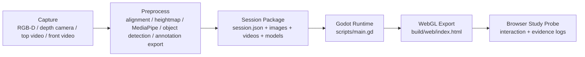
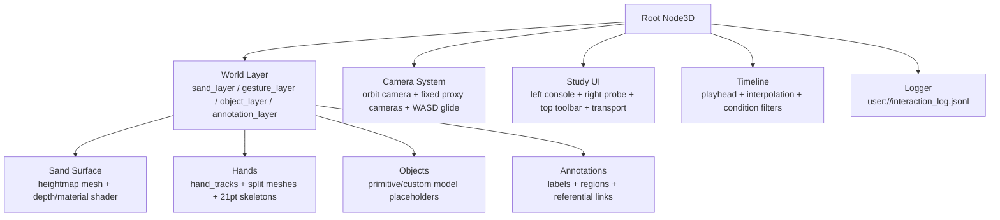

# Sand Stories Godot 架构文档

这份文档解释当前 Godot/WebGL 原型是怎么组织的，以及后面把真实 RGB-D 深度图、沙面材质图、MediaPipe 手部关键点、对象识别、研究标注接进来时，应该走哪条工程路径。

## 1. 当前目标

这个项目不是普通 3D viewer，而是一个面向 HCI/多模态分析的实验平台。它要把 sand storytelling session 里的几个证据层同步到同一条时间线上：

- 沙面重建：深度图或深度视频驱动的 displaced sand surface。
- 材质/颜色：与深度对齐的 RGB/material texture，可以是静态图或视频流。
- 手势：拆分后的左右手模型，加上 MediaPipe 21 点 landmark skeleton。
- 物体/工具：来自 YOLO、人工标注或后处理脚本的物体位置。
- 标注/解释层：gesture event、surface region、reference link、study task。
- 实验界面：condition selector、layer toggles、evidence logging、response draft。

整体思路是：外部 capture/post-processing 只负责把数据整理成 `session.json` 和资源文件；Godot runtime 负责加载、同步、渲染、交互和记录研究日志。

## 2. 高层数据流



实际项目里，目前 `session.json` 是主入口。资源路径都写成 Godot resource path，例如 `res://assets/heightmaps/...`、`res://assets/video/...`、`res://assets/models/...`。

## 3. 关键目录

- `scenes/Main.tscn`：Godot 主场景入口，挂载 `scripts/main.gd`。
- `scripts/main.gd`：核心 runtime，包含世界构建、UI、数据加载、时间线、手势、对象、标注、相机和日志。
- `assets/shaders/sand_depth.gdshader`：当前 WebGL 主沙面 shader，用 depth/height map 做 displacement，用 texture/material map 做表面颜色。
- `assets/shaders/sand_surface.gdshader`：早期 procedural sand shader，保留作为视觉参考。
- `assets/heightmaps/`：静态深度/高度图样例。
- `assets/source_images/`：与高度图对齐的 RGB/material 图片。
- `assets/video/depth_stream.ogv`：可选深度视频流，占位测试源。
- `assets/video/texture_stream.ogv`：可选材质视频流，占位测试源。
- `assets/models/hands.obj`：原始双手 OBJ，保留作为来源。
- `assets/models/hand_left.obj`：拆分后的左手单体模型。
- `assets/models/hand_right.obj`：拆分后的右手单体模型。
- `assets/fonts/NotoSansSC-VF.ttf`：打包进 WebGL 的 CJK 字体，保证中文姓名、中文任务文本和 3D 标注不依赖系统默认字体。
- `data/sample_session/session.json`：当前 demo session。
- `data/session_schema.json`：session 数据契约。
- `tools/split_hands_obj.py`：把原始双手 OBJ 按 face centroid 拆成左右手单体 OBJ。
- `tools/refresh_sample_hand_tracks.py`：重建 demo 的左右手 MediaPipe-style 21 点轨迹，右手会镜像，避免两个左手。
- `tools/build_web.ps1`：本地 WebGL 导出脚本。
- `tools/static_server.mjs`：本地静态服务器，用来跑 `build/web/index.html`。

## 4. Runtime 层次

`scripts/main.gd` 目前可以理解成六层：



### 4.1 Sand Surface

沙面由 `_build_sand_surface()` 创建，核心状态来自 `data_sources`：

- `depth_map`：静态深度图。
- `texture_map`：静态材质/RGB 图。
- `depth_video`：可选 OGV 深度视频。
- `texture_video`：可选 OGV 材质视频。
- `calibration.depth_uv_offset`：深度 UV 偏移。
- `calibration.texture_uv_offset`：材质 UV 偏移。
- `calibration.depth_uv_scale`：深度 UV 缩放。
- `calibration.texture_uv_scale`：材质 UV 缩放。
- `calibration.height_scale`：高度 displacement 强度。
- `calibration.material_strength`：材质贴图混合强度。

静态图和视频流共用同一个 shader 参数接口。视频流通过隐藏的 `VideoStreamPlayer` 提供 `get_video_texture()`；播放器本身不显示在 UI 上，否则会在画面中央冒出一块“不知道哪里来的图”。

### 4.2 Hand / Gesture Layer

手部层现在支持三种输入：

- `hand_tracks`：推荐格式。每只手一个 track，每个 track 有 `id`、`handedness`、`model_path`、`samples`。
- `mediapipe_hands`：frame-first 格式。每帧包含多个 hand，runtime 会归一化成 `hand_tracks`。
- `hand_samples`：旧格式，只支持单手。现在仅作为 fallback。

每个 hand track 会生成：

- 一个 root `Node3D`。
- 一个可选半透明 hand mesh ghost。
- 21 个 landmark 小球。
- 默认渲染程序化 hologram virtual hand：手掌半透明面片、每节手指胶囊/cylinder shell、指尖 glow。
- MediaPipe topology 对应的 cylinder bones 可作为 debug skeleton 打开，而不是默认显示 WebGL 线段。

手部动画不是按“最近帧”吸附，而是按 `playhead` 在相邻 capture samples 之间做时间重采样。默认 `interpolation: "cubic"`，也可以在 track 上改成 `linear` 或 `nearest`。这样 capture 每一帧都有 landmark、但 capture fps 不等于浏览器 render fps 时，显示仍然连续。

MediaPipe landmark 顺序采用标准 21 点：

```text
0 wrist
1-4 thumb
5-8 index
9-12 middle
13-16 ring
17-20 pinky
```

之前“两个左手”的根因是 demo 数据把两只手用了同一套左手 local template，只是平移到两个位置。现在 `tools/refresh_sample_hand_tracks.py` 对 `right_hand` 做了 local X mirror，并且分别绑定：

- `right_hand` -> `res://assets/models/hand_right.obj`
- `left_hand` -> `res://assets/models/hand_left.obj`

当前 demo 的第一帧可以用 thumb/pinky 的 X 关系快速 sanity-check：

- `right_hand` 的 thumb tip 在 pinky tip 的右侧。
- `left_hand` 的 thumb tip 在 pinky tip 的左侧。

### 4.3 Object Layer

`objects` 数组用于放入 session 里出现的实体、工具或 symbolic objects。当前支持：

- `primitive: "box"`
- `primitive: "sphere"`
- `primitive: "cylinder"`
- `model_path`：未来替换为真实 GLB/OBJ。
- `position`、`size`、`color`。

后续可以把 YOLO、Segment Anything、手工编码、或 paper method 里提到的 object coding 输出转换到这里。

### 4.4 Annotation / Reference Layer

这层是 HCI 分析最核心的解释层，不只是 UI 装饰。

- `surface_regions`：沙面上的可高亮区域，比如 river、route、island、home。
- `gesture_events`：按时间段编码的 drawing、pointing、independent、other。
- `references`：把 hand/object/annotation/surface region 连接起来的 link。
- `study_tasks`：实验任务和 participant prompt。

`_update_scene_from_time()` 会按当前 playhead 找 active event 和 active reference，决定哪些 label、region、link 应该亮起来。

### 4.5 Unicode / CJK Text Layer

后面如果有几十个中国 participant，风险点主要不是 JSON，而是 WebGL 里的字形。当前 runtime 做了三层兜底：

- `session.json`、`interaction_log.jsonl` 走 Godot `String` + JSON，按 UTF-8 文本读写。
- UI 根节点挂了项目内置 `NotoSansSC-VF.ttf`，普通 `Label`、`Button`、`TextEdit`、`OptionButton` 都继承这个字体。
- `Label3D` 标注也显式使用同一个字体，避免 3D 中文标注出现方块字。

用于快速检查的浏览器入口：

```text
http://127.0.0.1:8765/index.html?unicode=1
```

这个模式会临时注入 40 个中文姓名、中文任务文本、中文 3D 标注，并写入一次 `unicode_smoke_test` 日志事件。

## 5. 生命周期

Godot 场景启动后，大致顺序是：

1. `_ready()` 设置窗口、创建世界层、创建 UI、加载 session、应用 query params、设置 condition、渲染第一帧。
2. `_load_session()` 读取 `data/sample_session/session.json`，初始化 duration、data_sources、calibration 和所有 annotation data。
3. `_build_session_nodes()` 重建沙面、手、物体、标注和 reference link。
4. `_process(delta)` 推进时间线、更新 playhead、处理连续 WASD camera movement。
5. `_update_scene_from_time()` 根据时间更新手部插值、gesture event、annotation visibility、surface highlight 和 link state。
6. `_log_event()` 在关键交互时写入 `user://interaction_log.jsonl`。

## 6. 相机与输入

当前相机故意更像 3D 游戏/3D editor，而不是网页表单：

- 左键拖拽：orbit。
- Shift + 左键或中键：pan。
- 鼠标滚轮：zoom。
- `WASD` / 方向键：沿沙面连续 glide。
- `Shift`：移动加速。
- `Q` / `E`：键盘 zoom。
- `R`：reset camera。
- `1`：top view。
- `2`：front view。
- `3`：orbit/default view。
- `Tab`：播放/暂停。

WASD 不再是离散一步一步跳，而是有 acceleration/deceleration 的速度向量，所以移动感更像 3D scene navigation。

## 7. UI 结构

当前 UI 分成四块：

- 顶部 toolbar：condition、video stream、focus 3D、reference views、debug。
- 左侧 Layer Console：数据源、时间线、校准 slider、layer toggle、hand track 状态。
- 右侧 Study Probe：任务、condition 信息、evidence marker、response draft。
- 底部 dock/transport：播放、时间 slider、camera hint、固定视图占位。

视觉上现在走的是“research instrument / field lab console”的方向，而不是默认 Godot 控件堆叠。注意：这仍然是可工作的实验原型，不是最终 study participant UI。后面如果要正式做 experiment，可以把 researcher/debug 控件和 participant-facing task UI 分离。

## 8. WebGL 导出

推荐导出方式：

```powershell
cd C:\Users\lj200\Documents\ProjectUniMelb\Sandiv\SandStoriesGodot
.\tools\build_web.ps1
```

输出位置：

```text
build/web/index.html
build/web/index.pck
build/web/index.js
build/web/index.wasm
```

本地服务器通常跑在：

```text
http://127.0.0.1:8765/index.html
```

浏览器 query params：

- `?condition=baseline`
- `?condition=no_gestures`
- `?condition=no_objects`
- `?condition=no_sand`
- `?condition=stage2`
- `?video=1`
- `?view=top`
- `?view=front`
- `?debug=1`
- `?unicode=1`

组合例子：

```text
http://127.0.0.1:8765/index.html?condition=stage2&video=1&view=top
http://127.0.0.1:8765/index.html?unicode=1
```

## 9. 当前限制

- 现在的 depth/material OGV 还是 placeholder，不是真实 capture pipeline 输出。
- top/front reference views 目前是 Godot proxy camera，不是真实视频画面。
- MediaPipe 接口已经留好，但还没有内置 MediaPipe inference；推荐先离线跑 Python/JS preprocessing，再写入 `session.json`。
- 物体层现在偏 semantic placeholder，真实工具/物体 mesh 和 tracking 还没接。
- 日志已经能写 evidence/action，但还没有 study dashboard 或导出分析脚本。
- UI 已经比默认控件强很多，但正式 experiment 还需要 participant mode / researcher mode 分离。

## 10. 下一步工程建议

建议按这个顺序推进：

1. 先稳定 capture package 格式：每个 session 一个文件夹，里面放 `session.json`、depth/material/top/front/audio。
2. 做 preprocessing validator：检查路径是否存在、视频时长是否一致、landmark 是否 21 点、坐标是否在合理范围。
3. 做 calibration view：把 depth/material UV offset、scale、height scale 的调参结果写回 session。
4. 接真实 MediaPipe hands：输出 `hand_tracks` 或 `mediapipe_hands`，让 runtime 只负责显示。
5. 接真实 top/front streams：把 docked proxy view 替换成真实 reference video pane。
6. 做 study mode：隐藏 debug 控件，只保留任务、证据标记和 response 输入。
7. 做 analysis export：把 `interaction_log.jsonl` 和 session annotation 合并成可分析表格。
