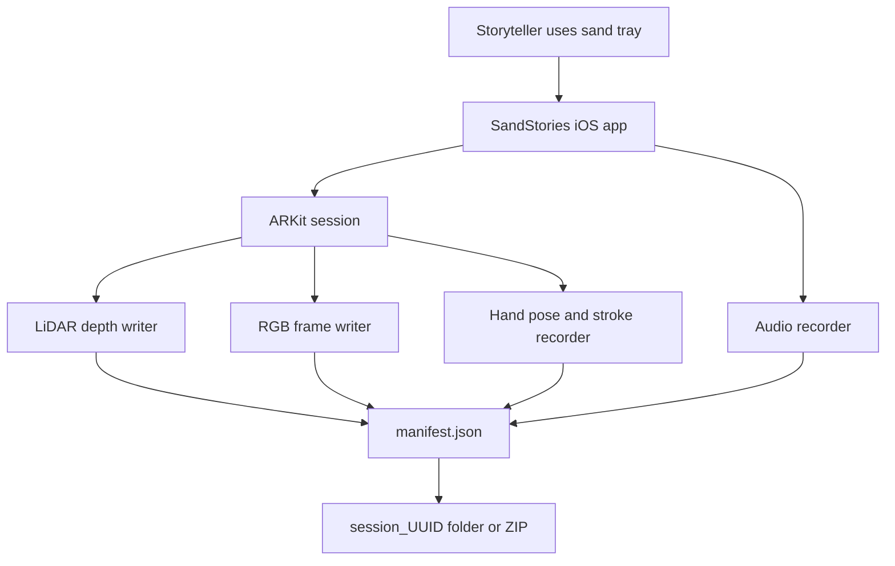
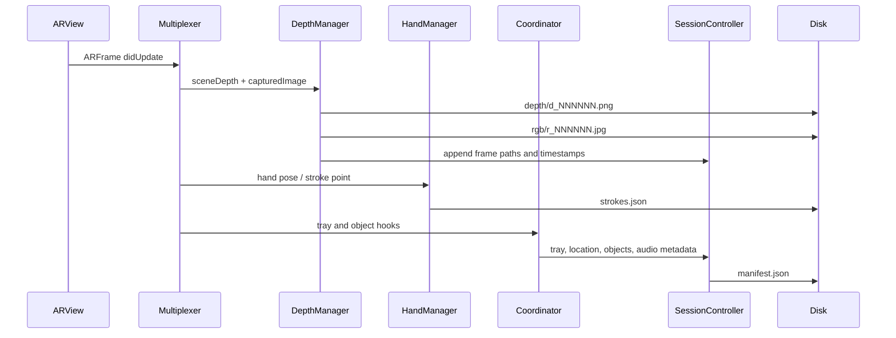
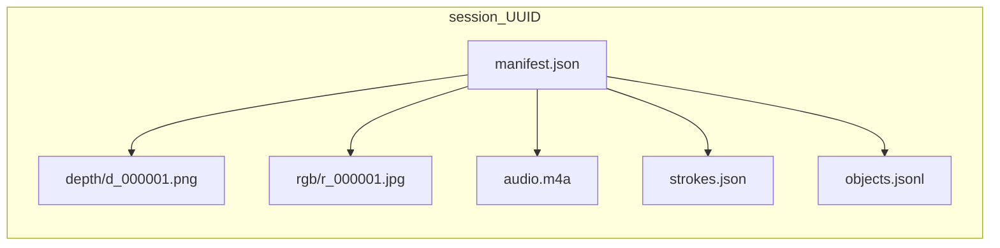
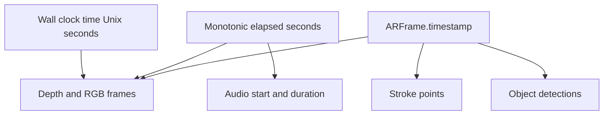

# SandStories

SandStories is an iOS AR capture app for recording sand storytelling sessions as synchronized multimodal data. It captures LiDAR depth, RGB camera frames, hand-drawn 3D strokes, microphone audio, object-detection hooks, tray boundary metadata, and location into a portable session folder that can be shared, visualized, and analyzed offline.

The project is built with Swift Package Manager and `xtool`, targeting iOS 17+.

## What The App Captures

Each session is saved as a self-contained folder named `session_<UUID>`. The canonical entry point is `manifest.json`, which indexes every modality and timestamp.



## Core Features

- **ARKit + LiDAR capture**: records scene depth as 16-bit grayscale PNG files.
- **RGB pairing**: saves JPEG camera frames paired with each persisted depth frame.
- **Shared timing model**: aligns modalities with ARKit timestamps and monotonic session elapsed time.
- **Stroke recording**: stores 3D hand stroke polylines in AR/world coordinates.
- **Audio capture**: records AAC audio into `audio.m4a` for full session context.
- **Tray and object hooks**: includes tray boundary metadata and append-friendly object detections.
- **External storage support**: can save sessions internally or to a Files/USB-C external folder.
- **Benchmark mode**: runs a timed depth-only capture benchmark and reports throughput/encoding metrics.
- **Share/export flow**: packages the full session folder into an IPA-shareable ZIP.

## Repository Layout

```text
SandStories/
├── AppSupport/
│   └── SandStories-App-Info.plist      # iOS privacy usage descriptions
├── Sources/SandStories/
│   ├── ContentView.swift               # Main SwiftUI surface
│   ├── RecordingCoordinator.swift      # Capture session lifecycle
│   ├── DepthCaptureManager.swift       # LiDAR/RGB persistence and benchmark metrics
│   ├── CaptureSessionController.swift  # manifest.json and objects.jsonl writer
│   ├── StrokeRecorder.swift            # 3D stroke persistence
│   ├── SessionManifestModels.swift     # Canonical exported data schema
│   └── ...
├── docs/
│   ├── INSTALL_IPA.md
│   └── VISUALIZE_SESSION.md
├── scripts/
│   ├── build_release_ipa.sh
│   ├── merge_privacy_into_app.sh
│   └── visualize_sandstories_session.py
├── Package.swift
└── xtool.yml
```

## Capture Flow

The app uses an `ARSessionDelegate` multiplexer so depth capture, hand pose capture, and auxiliary frame processing can all receive AR frames.



## Exported Data Format

The exported session is intentionally simple: standard files plus a JSON manifest. This makes the output easy to inspect in Python, MATLAB, ImageJ/Fiji, or custom tooling.



### `manifest.json`

`manifest.json` is defined by `CaptureSessionManifest` and includes:

- Session identity, app version, device model, and OS version.
- Wall-clock start/end timestamps.
- Monotonic session elapsed time for cross-modality alignment.
- ARKit time reference.
- Storage destination metadata.
- Depth encoding settings.
- Depth/RGB frame entries with relative paths and timestamps.
- Optional audio metadata.
- Stroke/object/tray/location references.

### Depth Encoding

Depth is stored as 16-bit PNG so the raw depth values remain lossless.

```text
meters = (uint16_value / 65535.0) * maxDepthMeters
```

- `0` means invalid/no depth.
- `maxDepthMeters` is stored in `manifest.json`.
- The current format string is `png16_grayscale_zlib`.

### Timing Model



Use `monotonicElapsedSeconds` for session-local alignment. Use `arTimestamp` when correlating directly with ARKit frame timing.

## Benchmark Mode

The app includes a **Benchmark** button in the bottom toolbar. It runs a 15-second depth-only capture session and reports:

- AR frame rate.
- Saved depth/RGB frame rate.
- Number of saved frames.
- Motion-gated skips.
- Frames without depth.
- Average depth PNG encode time.
- Average RGB JPEG encode time.
- Total depth/RGB storage size.

This benchmark is designed to compare the current PNG-based capture path against future storage formats such as lossless depth video or compressed depth chunks.

## Visualizing A Session

Install dependencies and run the included script:

```bash
pip install numpy pillow matplotlib
python scripts/visualize_sandstories_session.py "/path/to/session_UUID" --frame 0
```

Save a visualization instead of opening a window:

```bash
python scripts/visualize_sandstories_session.py "/path/to/session_UUID" --frame 0 --save frame_0.png
```

See [`docs/VISUALIZE_SESSION.md`](docs/VISUALIZE_SESSION.md) for details on ImageJ/Fiji, MATLAB, and OpenCV workflows.

## Building The App

Build a release app and package an IPA:

```bash
./scripts/build_release_ipa.sh
```

The script:

1. Runs `xtool dev build -c release`.
2. Merges privacy usage descriptions from `AppSupport/SandStories-App-Info.plist`.
3. Packages `xtool/SandStories.ipa`.

The privacy merge step is required because iOS will terminate apps that access camera, LiDAR/world sensing, location, or microphone without the matching `Info.plist` usage descriptions.

## Requirements

- iOS 17+.
- LiDAR-capable iPhone/iPad for depth capture.
- Swift 6.2 toolchain.
- `xtool` for iOS packaging from this Swift Package project.
- Python 3 with `numpy`, `pillow`, and `matplotlib` for visualization tooling.

## Development Notes

- Build products are ignored: `.build/`, `xtool/`, `DerivedData/`, and local Python virtual environments should not be committed.
- The current canonical data schema is `schemaVersion: 1`.
- Existing exported sessions remain readable as long as tools start from `manifest.json`.
- Future storage experiments should preserve exact 16-bit depth semantics before replacing the PNG path.

