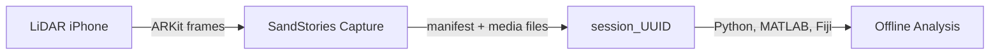
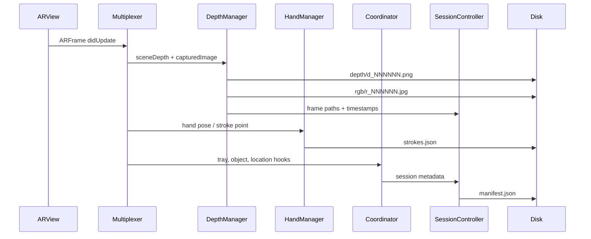
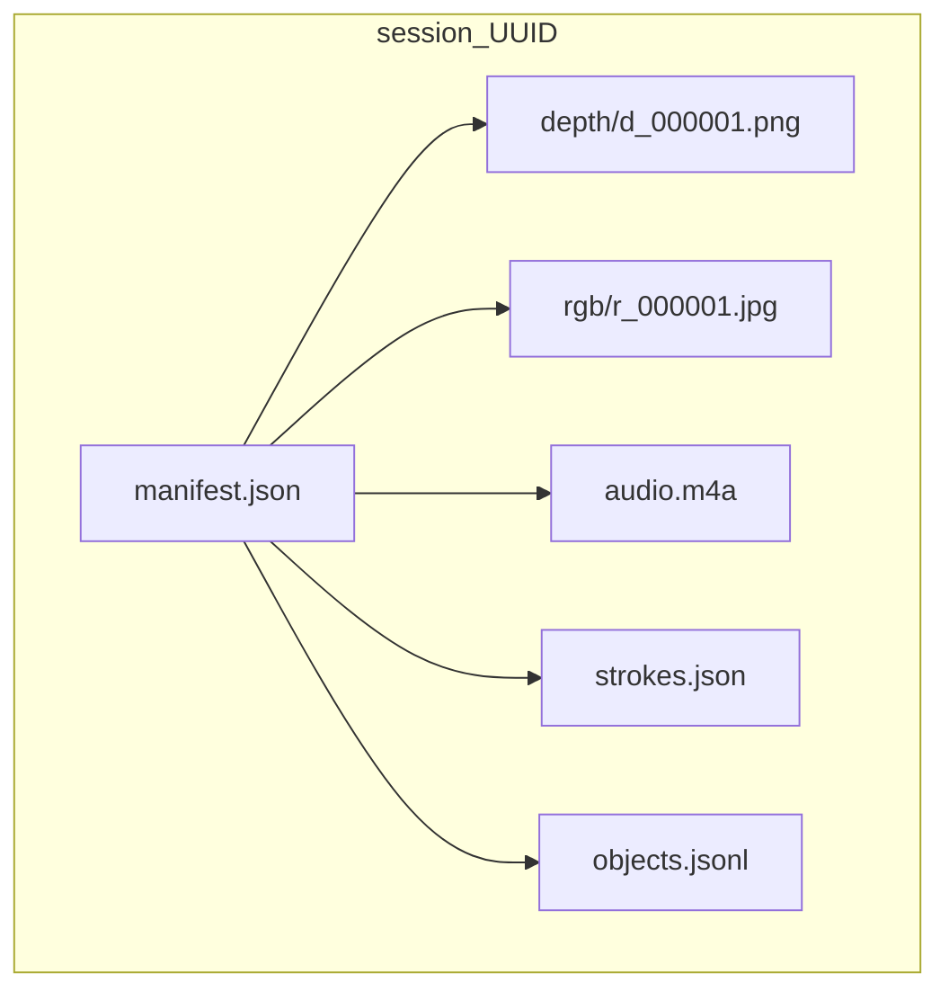
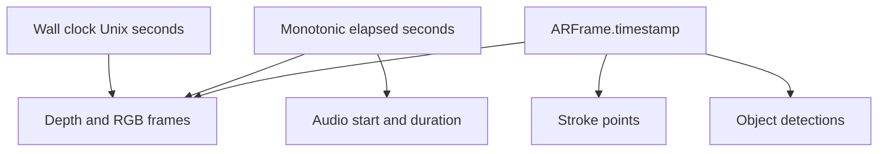

# SandStories

Capture sand storytelling sessions as synchronized LiDAR depth, RGB video frames, audio, and 3D stroke data.

SandStories is an iOS AR capture app for research-style recording of sand tray storytelling sessions. It uses ARKit, LiDAR scene depth, camera frames, hand pose input, microphone audio, and location metadata to produce a portable session folder that can be shared and analyzed offline.

```text
iPhone ARKit + LiDAR  ──▶  Session Writer  ──▶  manifest.json + depth/RGB/audio/strokes
  scene depth frames          timestamp sync        Python / MATLAB / Fiji analysis
  RGB camera frames           manifest index        ZIP export for sharing
  hand stroke points          storage routing       benchmark data for format tests
```

## What Works Today

The app runs on a physical LiDAR-capable iPhone/iPad and records packaged sessions into app storage or an external Files/USB-C destination. Each session includes a `manifest.json` file, motion-gated 16-bit depth PNGs, paired RGB JPEGs, optional AAC audio, 3D stroke data, location metadata, and placeholder object-detection/tray-boundary hooks.

There is also a **Benchmark** button that runs a 15-second depth-only capture test and reports AR frame rate, saved frame rate, motion skips, no-depth frames, PNG/JPEG encode time, and total depth/RGB size. This gives a baseline for comparing the current PNG format against future compressed depth storage.



## What Does Not Work Yet

- Object detection is currently a stubbed pipeline hook rather than a trained/story-specific detector.
- Tray boundary detection is heuristic and may remain `pending` for difficult scenes.
- Depth is currently stored as individual PNG files; compressed depth chunks and lossless depth video are planned but not implemented.
- The Python visualization script shows one selected frame at a time; full session reports/contact sheets are future tooling.
- Simulator support is not a goal for real capture because ARKit scene depth requires physical hardware.

## Hardware

| Component | Notes |
| --- | --- |
| LiDAR-capable iPhone/iPad | Required for ARKit scene depth capture |
| iOS 17+ device | Physical device only for real capture |
| Sand tray / storytelling surface | Subject being captured |
| Optional external SSD or Files folder | Used for longer sessions or easier transfer |
| Mac/Linux/Windows machine | Used for Python visualization and offline analysis |

## Build And Run

This project is a Swift Package Manager app packaged with `xtool`.

```bash
./scripts/build_release_ipa.sh
```

The build script:

1. Runs `xtool dev build -c release`.
2. Merges iOS privacy usage descriptions from `AppSupport/SandStories-App-Info.plist`.
3. Packages `xtool/SandStories.ipa`.

The privacy merge step matters. iOS will terminate an app that accesses camera, LiDAR/world sensing, location, or microphone without the corresponding `Info.plist` usage descriptions.

See [`docs/INSTALL_IPA.md`](docs/INSTALL_IPA.md) if the app crashes on launch after manual packaging.

### CI (no Mac)

GitHub Actions builds a downloadable IPA on Ubuntu. See [`docs/CI.md`](docs/CI.md) for setup (one-time Darwin SDK bootstrap) and how to install the artifact on your iPhone.

## Architecture

SandStories is intentionally organized around the session lifecycle: AR frames enter through a delegate multiplexer, modality-specific components write their data, and `CaptureSessionController` keeps the manifest consistent.



Key source files:

- `SandStoriesApp.swift` — SwiftUI app entry point.
- `ContentView.swift` — main AR UI, capture controls, benchmark button, export sheet.
- `ARSessionDelegateMultiplexer.swift` — fans ARKit delegate callbacks out to capture subsystems.
- `RecordingCoordinator.swift` — owns start/stop flow, storage destination, audio, location, tray/object hooks, and benchmark mode.
- `DepthCaptureManager.swift` — converts ARKit scene depth to 16-bit PNG, writes paired RGB JPEGs, and records throughput metrics.
- `CaptureSessionController.swift` — creates session folders, writes `manifest.json`, and appends `objects.jsonl`.
- `HandPoseCaptureManager.swift` and `StrokeRecorder.swift` — convert hand pose events into 3D stroke polylines.
- `SessionManifestModels.swift` — canonical schema for exported sessions.
- `ShareExportManager.swift` and `SimpleZipWriter.swift` — package sessions for sharing.

## Data Format

Each recording is a self-contained folder named `session_<UUID>`. The canonical entry point is `manifest.json`; all other files are referenced relative to the session root.



`manifest.json` contains:

- Session ID, device model, app version, and OS version.
- Wall-clock start/end time.
- Monotonic elapsed session time for cross-modality alignment.
- ARKit timestamp reference.
- Storage destination metadata.
- Depth encoding settings.
- Depth and RGB frame entries with relative paths and timestamps.
- Optional audio metadata.
- Stroke, object-detection, tray-boundary, and location metadata.

Current depth format:

```text
format = png16_grayscale_zlib
meters = (uint16_value / 65535.0) * maxDepthMeters
```

`0` means invalid/no depth. `maxDepthMeters` is stored in `manifest.json`.

## Timing Model

The app stores multiple time bases because different analysis tasks need different alignment guarantees.



Use `monotonicElapsedSeconds` for session-local alignment across modalities. Use `arTimestamp` when correlating directly with ARKit frames.

## Visualize Session Data

The repository includes a Python script for opening a recorded session and viewing a selected depth/RGB frame.

```bash
pip install numpy pillow matplotlib
python scripts/visualize_sandstories_session.py "/path/to/session_UUID" --frame 0
```

Save the visualization to disk:

```bash
python scripts/visualize_sandstories_session.py "/path/to/session_UUID" --frame 0 --save frame_0.png
```

See [`docs/VISUALIZE_SESSION.md`](docs/VISUALIZE_SESSION.md) for ImageJ/Fiji, MATLAB, and OpenCV workflows.

## Project Structure

```text
SandStories/
  AppSupport/
    SandStories-App-Info.plist          iOS privacy usage descriptions
  Sources/SandStories/
    SandStoriesApp.swift                App entry point
    ContentView.swift                   Main SwiftUI capture UI
    RecordingCoordinator.swift          Session lifecycle orchestration
    DepthCaptureManager.swift           LiDAR/RGB persistence and benchmark metrics
    CaptureSessionController.swift      manifest.json and objects.jsonl writer
    HandPoseCaptureManager.swift        Hand pose integration
    StrokeRecorder.swift                3D stroke persistence
    SessionManifestModels.swift         Exported data schema
    ShareExportManager.swift            Session export helpers
  docs/
    INSTALL_IPA.md                      IPA/privacy troubleshooting
    VISUALIZE_SESSION.md                Offline visualization guide
  scripts/
    build_release_ipa.sh                Release app + IPA build
    merge_privacy_into_app.sh           Info.plist privacy merge
    visualize_sandstories_session.py    Depth/RGB visualization tool
  Package.swift                         Swift package definition
  xtool.yml                             iOS bundle identifier config
```

## Roadmap

- Phase 1: Stable packaged session capture with PNG depth, RGB, audio, strokes, and manifest metadata.
- Phase 2: Session analysis tooling: summaries, contact sheets, depth quality metrics, and stroke timelines.
- Phase 3: Storage benchmark: compare PNG depth against lossless depth video and compressed 16-bit depth chunks.
- Phase 4: Stronger tray detection and story-object detection.
- Phase 5: Dataset viewer/dashboard for reviewing many sessions side by side.

The biggest open technical question is the best storage format for high-rate, exact 16-bit depth. PNG is simple and reliable, but may be too slow or file-heavy for longer sessions. The next candidates are lossless depth video or an indexed compressed depth chunk stream.

## Dependencies

### iOS

Apple frameworks only:

- ARKit
- RealityKit
- SwiftUI
- CoreLocation
- Vision
- AVFoundation

### Tooling

- Swift 6.2 toolchain.
- `xtool` for packaging the iOS app.
- Python 3 with `numpy`, `pillow`, and `matplotlib` for visualization.

## Repository Hygiene

Build products and local scratch files are intentionally ignored:

- `.build/`
- `xtool/`
- `DerivedData/`
- `.venv*/`
- local transcription scratch files

The repository should contain source, scripts, docs, and lightweight configuration only.

