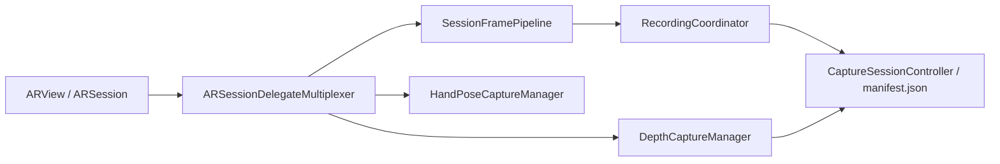

# SandStories — LLM Context Document

> **Purpose:** This file summarizes the full Cursor chat history and project state so another LLM (or human) can continue work without re-reading the entire conversation.
>
> **Source transcript:** `2eb0251e-27ce-45e5-9733-2cd9a902d109` (Cursor agent session, May–Jun 2026)
>
> **Last updated:** 2026-06-08 (after third failed GitHub Actions CI run)

---

## 1. User & Environment

| Item | Value |
|------|--------|
| **User** | Vijit Pugalia (`VijitPugalia` on GitHub) |
| **Email** | vijitpugalia0@gmail.com |
| **Machine** | Windows PC `NitroV` with WSL2 Ubuntu |
| **WSL project path** | `/home/vijitpugalia/SandStories` |
| **Windows path (WSL)** | `\\wsl$\Ubuntu\home\vijitpugalia\SandStories` |
| **Git remote** | `git@github.com:VijitPugalia/SandStories.git` (private) |
| **Git push** | Works over SSH |
| **GitHub CLI (`gh`)** | Logged in as `VijitPugalia` but **cannot access private repo** (HTTP 404 on Actions API — PAT likely lacks `repo` scope for private repos) |
| **Browser MCP** | Was requested for GitHub login/Actions inspection; **not available** in agent sessions |
| **iPhone** | LiDAR-capable, iOS 17+; installs IPAs via **SideStore** |
| **No Mac** | User develops on WSL with **xtool** cross-compile; wants **GitHub Actions** for automated IPA builds |

---

## 2. Project Summary

**SandStories** is an iOS 17+ AR/LiDAR app for capturing sand-tray storytelling sessions as multimodal research data.

### What it captures per session

- **LiDAR depth** — motion-gated 16-bit PNGs (`depth/d_*.png`)
- **RGB camera** — JPEG frames (`rgb/r_*.jpg`)
- **Audio** — optional AAC (`audio.m4a`)
- **3D strokes** — hand-drawn points in AR space
- **Location** metadata
- **Manifest** — `manifest.json` indexes all modalities with timestamps

Sessions are stored as `session_<UUID>/` (sometimes nested inner folder with short UUID suffix).

### Build stack

- **SwiftPM** + **xtool** (not Xcode project)
- Config: `xtool.yml` — bundle ID `com.vijitpugalia.sandstories`, icon `Resources/AppIcon.png`
- Build: `./scripts/build_release_ipa.sh` → `xtool/SandStories.ipa`
- Privacy keys merged post-build from `AppSupport/SandStories-App-Info.plist` (required for ARKit/camera/mic/location)

### Key frameworks (iOS only)

ARKit, RealityKit, Vision, AVFoundation, CoreLocation — see `Package.swift`.

---

## 3. Chronological User Requests (Chat History)

| # | Request | Outcome |
|---|---------|---------|
| 1 | Upload WSL project to GitHub | Guided through git init, identity, SSH key, remote fix |
| 2 | Fix git commit identity / SSH push errors | Remote set to `VijitPugalia/SandStories`, SSH keygen |
| 3 | WSL location of SandStories | `/home/vijitpugalia/SandStories` |
| 4 | Explain current data format | Documented manifest + depth PNG + RGB JPEG structure |
| 5 | Try depth **video** instead of PNGs for speed | Plan evaluated; benchmark added to measure; uint16-preserving options discussed |
| 6 | Option C compression / balanced method | Plan updated with compressed chunk stream (`lzfse`) concept |
| 7 | Add **Benchmark** button + build app | Implemented 15s depth benchmark; built IPA |
| 8 | Benchmark **crashes on tap** | Fixed: benchmark now skips audio (`recordAudio: false`); safer string formatting |
| 9 | How to analyze output data | Docs + `scripts/visualize_sandstories_session.py` |
| 10 | Visualize session at `C:\Users\vijit\Downloads\session_EA168C1B-...` | Validated files; visualization guidance |
| 11 | Push changes to GitHub with commit message | Pushed |
| 12 | Clean repo + senior-quality README with diagrams | README revamp, removed cruft |
| 13 | Push README cleanup | Pushed |
| 14 | Restructure README like `nickmeinhold/lidar-robot-arm` | README rewritten: What Works / Doesn't / Hardware / Architecture |
| 15 | Use image as app logo | `Resources/AppIcon.png` + `xtool.yml` iconPath |
| 16 | Send IPA to connected iPhone | Explained limitations; manual SideStore install |
| 17 | App **crashes after extended use** | Fixed memory/retention issues (see §5) |
| 18 | Open IPA folder | `xtool/SandStories.ipa` |
| 19 | App icon + restore **LiDAR mesh overlay** (colored triangles by distance) | Icon set; removed PIP depth preview; restored `sceneReconstruction = .mesh` |
| 20 | Avoid reinstalling IPA every time | Discussed options; user chose manual install |
| 21 | Wi-Fi install via SMB or network | SMB attempted — iPhone showed folder but **"content unavailable"** |
| 22 | HTTP download server for IPA | Worked briefly (`:8877`); user later asked to **remove all share scripts** |
| 23 | Remove unnecessary Wi-Fi/SMB files | All share scripts removed; manual SideStore path only |
| 24 | What to do with benchmark session `Benchmark_session_2E793673-...` | Analyzed; baseline doc + visualization |
| 25 | GitHub Actions CI without Mac — good idea? | Yes; CI implemented |
| 26 | **"Do all of this for me"** (CI bootstrap, secrets, browser) | Partially done — see §6 |
| 27 | Third CI run failed; create this context MD | This document |

---

## 4. Architecture (Current)



### UI / AR configuration (`ContentView.swift`)

- **LiDAR mesh overlay:** `showSceneUnderstanding` + `config.sceneReconstruction = .mesh` — colored distance-based triangles (user explicitly wanted this, NOT a picture-in-picture depth preview)
- **Removed:** `DepthPreviewStore` / PIP depth overlay (user said this was wrong)

### Benchmark flow

- 15-second capture, **no audio**
- Reports: AR fps, saved fps, motion skips, encode times, total bytes
- `DepthCaptureBenchmarkSnapshot` in `DepthCaptureManager.swift`

---

## 5. Major Code Fixes Applied

### 5.1 Extended-use crash fixes (commit `eedb856`)

| Issue | Fix | File(s) |
|-------|-----|---------|
| Retaining `ARFrame` in async Task | Extract timestamp + `PixelBufferBox` synchronously; don't pass whole frame | `SessionFramePipeline.swift` |
| Race conditions / Swift 6 actor issues | Serial `DispatchQueue` instead of `NSLock` in async paths | `HandPoseCaptureManager`, `DepthCaptureManager`, `SessionFramePipeline` |
| Manifest I/O every frame | Batch writes every 5 frames; flush on stop | `CaptureSessionController` |
| Hand pose memory | Single fingertip `ModelEntity` instead of per-point spheres | Hand pose code |
| Benchmark crash | `recordAudio: false` for benchmark sessions | `RecordingCoordinator.swift` |

### 5.2 Mesh overlay restoration

- Re-enabled scene understanding mesh in AR config
- Removed depth PIP overlay components

### 5.3 App icon

- `Resources/AppIcon.png` committed (required by `xtool.yml` and CI)

---

## 6. GitHub Actions CI — Status & History

### Goal

Build `SandStories.ipa` on every push to `main` without a local Mac; user downloads artifact and installs via SideStore.

### Three failed runs (as of 2026-06-08)

| Run | Commit | Runner | Likely failure cause | Fix attempted |
|-----|--------|--------|---------------------|---------------|
| **1** | `eedb856` | `ubuntu-24.04` | No Darwin Swift SDK on Linux runner | Documented SDK bootstrap; user has no local SDK/Xcode.xip |
| **2** | `3173ceb` | `macos-15` | `brew install xtool-org/tap/xtool` — **formula vs cask** (xtool is only a Homebrew **cask**) | Switched to macOS runner |
| **3** | `b6428f6` | `macos-15` | **Unknown** — agent could not read logs (no `gh` private repo access, no browser MCP) | Fixed install to download `xtool.app.zip` directly |

### Current workflow (`.github/workflows/build-ipa.yml`)

```yaml
runs-on: macos-15
steps:
  - checkout
  - xcrun -sdk iphoneos -show-sdk-path
  - bash scripts/ci-setup-xtool-macos.sh   # downloads xtool 1.17.0 app zip
  - which xtool && xtool --version
  - bash scripts/build_release_ipa.sh
  - upload-artifact: xtool/SandStories.ipa
```

### CI scripts

| Script | Purpose |
|--------|---------|
| `scripts/ci-setup-xtool-macos.sh` | Download `xtool.app.zip` v1.17.0 → `/Applications/xtool.app`, add bin to `GITHUB_PATH` |
| `scripts/ci-setup-xtool.sh` | Linux CI: AppImage + Darwin SDK (cache / `DARWIN_SDK_TARBALL_URL` secret) |
| `scripts/ci-pack-darwin-sdk.sh` | Pack local SDK after `xtool setup` for Linux CI bootstrap |
| `scripts/build_release_ipa.sh` | `xtool dev build -c release` → merge privacy plist → zip IPA |

### Pinned versions (`.github/xtool-version.env`)

```
XTOOL_VERSION=1.17.0
SWIFT_VERSION=6.2
```

### Local WSL build status

- `xtool sdk status` → **Not installed**
- No `darwin.artifactbundle` found locally
- No `Xcode*.xip` found on Windows (search timed out / empty)
- **Local `./scripts/build_release_ipa.sh` may also fail** until `xtool setup` with Xcode.xip

### What the next LLM should do for CI

1. **Get the actual failure log** from run #3:
   - User pastes failed step output, OR
   - `gh auth refresh -h github.com -s repo,workflow,actions` then `gh run view --log`
2. **Likely next failures** (if install step passed):
   - `xtool dev build` compile/signing error on macOS
   - Missing `xtool setup` on macOS (may or may not be required when Xcode SDK is present)
   - Swift 6.2 / Package.swift platform mismatch
   - `merge_privacy_into_app.sh` or IPA zip step
   - `macos-15` image issue → try `macos-14`
3. If macOS CI keeps failing, consider:
   - Ubuntu + `DARWIN_SDK_TARBALL_URL` secret (user must provide Xcode.xip once)
   - Self-hosted runner with Xcode

### Blockers for automated GitHub config

- `gh api repos/VijitPugalia/SandStories/actions/runs` → **404**
- `SandStories` not in `gh repo list` (private, token scope)
- Browser MCP tools unavailable for Actions UI inspection

---

## 7. Data Format Reference

### Session folder layout

```
session_<UUID>/
  manifest.json
  depth/
    d_000000.png    # 16-bit depth PNGs
  rgb/
    r_000000.jpg
  audio.m4a         # optional (absent in benchmark mode)
  strokes/          # 3D stroke data
```

### Benchmark session analyzed

- **Path:** `C:\Users\vijit\Downloads\Benchmark_session_2E793673-AB62-40B3-A27D-6AFBF839C16E\F839C16E`
- **54** depth PNGs + **54** RGB JPEGs, ~15s, ~21 MB, ~3.6 saved fps, no audio
- **Report:** `docs/benchmark_baseline_2E793673.md`
- **Visualization:** `C:\Users\vijit\Downloads\benchmark_frame_0.png`

### Analysis tooling

```bash
pip install numpy pillow matplotlib
python3 scripts/visualize_sandstories_session.py <session_folder>
```

See `docs/VISUALIZE_SESSION.md`.

---

## 8. IPA Install Workflow (Current)

**No automated Wi-Fi/SMB install** — removed per user request.

1. Build locally: `./scripts/build_release_ipa.sh` → `xtool/SandStories.ipa`
   - Or download from GitHub Actions artifact (when CI works)
2. Copy IPA to Windows if needed: `\\wsl$\Ubuntu\home\vijitpugalia\SandStories\xtool\SandStories.ipa`
3. Install via **SideStore** on iPhone
4. If app crashes on launch: see `docs/INSTALL_IPA.md` (privacy plist merge)

`xtool devices` / USB install from WSL was reported to hang (USB passthrough issues).

---

## 9. Git Commit History (main)

| Commit | Message |
|--------|---------|
| `f7ef5aa` | Initial commit: SandStories iOS app |
| `5b9e503` | Add depth capture benchmark flow |
| `12e3798` | Document project architecture and clean repo |
| `d85dd18` | Revamp README and remove exec bits from scripts |
| `eedb856` | Add GitHub Actions IPA build and stabilize AR capture |
| `3173ceb` | Switch CI to macOS runners so IPA builds without SDK secrets |
| `b6428f6` | Fix macOS CI xtool install (cask vs formula) |

---

## 10. Key Files Map

```
SandStories/
├── Package.swift                 # SwiftPM, iOS 17+, linked frameworks
├── xtool.yml                     # bundle ID, AppIcon path
├── Resources/AppIcon.png         # Required for build + CI
├── AppSupport/SandStories-App-Info.plist  # Privacy usage strings
├── Sources/SandStories/
│   ├── ContentView.swift         # AR config, mesh overlay
│   ├── SessionFramePipeline.swift
│   ├── DepthCaptureManager.swift # Benchmark + depth write
│   ├── RecordingCoordinator.swift
│   └── ...
├── scripts/
│   ├── build_release_ipa.sh
│   ├── merge_privacy_into_app.sh
│   ├── ci-setup-xtool-macos.sh
│   ├── ci-setup-xtool.sh
│   ├── ci-pack-darwin-sdk.sh
│   └── visualize_sandstories_session.py
├── .github/
│   ├── workflows/build-ipa.yml
│   └── xtool-version.env
├── docs/
│   ├── CI.md
│   ├── INSTALL_IPA.md
│   ├── VISUALIZE_SESSION.md
│   ├── benchmark_baseline_2E793673.md
│   └── LLM_CONTEXT.md            # This file
└── xtool/
    └── SandStories.ipa           # Build output (not always committed)
```

---

## 11. Removed / Rejected Approaches

Do **not** re-add unless user asks:

- Windows SMB share (`SandStories` on `C:\Users\vijit\SandStoriesIPA`) — iPhone "content unavailable"
- HTTP server on port 8877 for IPA download — worked briefly, user asked to remove
- Scripts: `setup_windows_ipa_share.*`, `fix_windows_smb_for_iphone.*`, `ensure_windows_ipa_share.sh`, `start_ipa_http_server.*`
- Picture-in-picture depth preview overlay — user wanted **mesh triangles**, not PIP depth view

---

## 12. Open Tasks / Priorities

### P0 — CI must pass

- [ ] Obtain run #3 failure log (Build release IPA step most likely)
- [ ] Fix root cause and push
- [ ] Verify artifact `SandStories-ipa` uploads

### P1 — User workflow

- [ ] Optional: `gh auth refresh` for private repo Actions access
- [ ] Optional: restore local WSL builds via `xtool setup` + `Xcode_16.3.xip`

### P2 — Future features (discussed, not implemented)

- [ ] Compressed depth stream / lossless depth video (replace per-frame PNGs)
- [ ] Full session visualization reports
- [ ] Object detection (currently stubbed)

---

## 13. Instructions for the Next LLM

1. **Read this file first**, then `README.md`, `docs/CI.md`, and the failed Actions log.
2. **Do not drop AR/LiDAR features** — user explicitly wants full iOS capabilities via xtool cross-compile or GHA macOS builds.
3. **Prefer minimal diffs** — match existing code style; don't re-add removed Wi-Fi/SMB scripts.
4. **Privacy plist merge is mandatory** after every `xtool dev build`.
5. **LiDAR UI** = colored mesh triangles (`sceneReconstruction = .mesh`), not PIP depth preview.
6. **Only commit when user asks** — they have been pushing via agent when requested.
7. **Git push works over SSH**; `gh` API may not work for private repo without scope refresh.
8. If CI logs show `xtool dev build` failure, check xtool macOS docs for whether `xtool setup` or ad-hoc signing env vars are needed on GHA.

---

## 14. Raw User Messages (Verbatim Index)

For full verbatim text, read the JSONL transcript at:
`/home/vijitpugalia/.cursor/projects/home-vijitpugalia-SandStories/agent-transcripts/2eb0251e-27ce-45e5-9733-2cd9a902d109/2eb0251e-27ce-45e5-9733-2cd9a902d109.jsonl`

Notable verbatim queries:

- *"how can i access the files of this as this is inside the WSL i want to upoload all this to github"*
- *"it crashed as soon as i clicked the benchmark buttton, fix and find the bug."*
- *"the app is crashing after some use, why is that."*
- *"you have created a depth view, which is not needed, I need the hexagonal shapes... bring that back"*
- *"I dont have to drop features because i dont have mac device, I can use github actions to compile the app"*
- *"Do all of this for me"*
- *"The new one failed as well"*
- *"The third one failed as well, Can you made a md file which has all the chat history that other llm can read and understand the context"*

---

## 15. Contact / Repo Links

- **GitHub:** https://github.com/VijitPugalia/SandStories (private)
- **Actions:** https://github.com/VijitPugalia/SandStories/actions
- **xtool:** https://github.com/xtool-org/xtool (v1.17.0)
- **xtool docs:** https://xtool.sh
